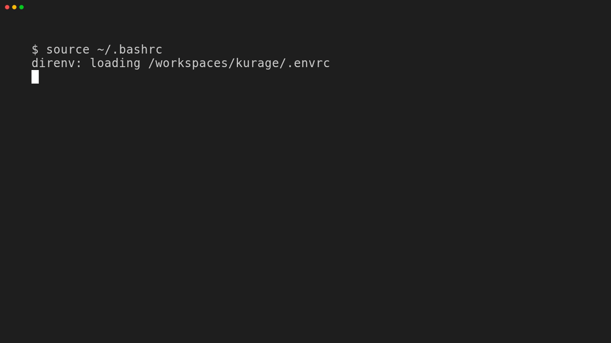
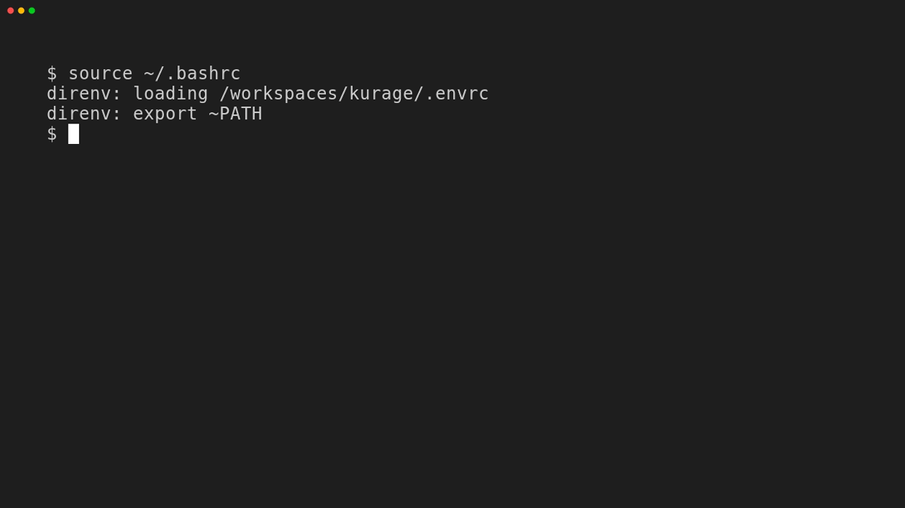

# Kurage


## 概要

Kurage は、Node.js と Bun で動作する JavaScript ランタイムツールです。

JavaScript の実行、外部コマンドの実行、JSON 形式での実行結果の取得など、開発やスクリプト作成に役立つ機能を提供します。

## 特徴

- **複数のランタイムに対応** — Node.js と Bun で動作
- **JavaScript をすぐに実行** — コードの評価やファイルの実行に対応
- **外部コマンドを実行** — コマンドの実行結果を JSON 形式で取得可能
- **対話的に利用** — REPL で JavaScript を実行
- **開発支援 API** — ファイル操作、テキスト処理、ログ、時間計測などの機能を提供

## インストール

### ブラウザで試す

GitHub Codespaces を使えば、ローカル環境にインストールせずにブラウザから試せます。

[](https://codespaces.new/mskz-3110/kurage?quickstart=1)

[GitHub Codespaces で開く](https://codespaces.new/mskz-3110/kurage?quickstart=1)

セットアップスクリプトにより、環境の違いを吸収し、必要な開発環境を構築します。

コンテナのビルド時間：約3分

### pnpm でインストール

```bash
pnpm add kurage
```

### 単一バイナリで利用

GitHub Releases から単一バイナリをダウンロードして利用できます。

[GitHub Releases](https://github.com/mskz-3110/kurage/releases)

## クイックスタート

基本的なコマンドの使い方をデモで紹介します。

### 対話的に実行する


```bash
kurage repl
```

### JavaScript を直接実行する


```bash
kurage eval 'kurage.logger.out("Hello, Kurage!")'
```

### 外部コマンドを実行する


```bash
kurage exec node --version
```

### JavaScript ファイルを実行する


```bash
kurage run script.js
```

## 便利な機能

### コマンド実行結果を JSON で取得する


```bash
kurage exec-json node --version
```

### 実行環境の情報を取得する



```bash
kurage info-json
```

### ファイルの内容を処理する



```bash
kurage txcl README.md
```

### JavaScript API

ファイル操作、テキスト処理、ログ、時間計測などの API を利用できます。

## ライセンス

[Apache-2.0](LICENSE)
