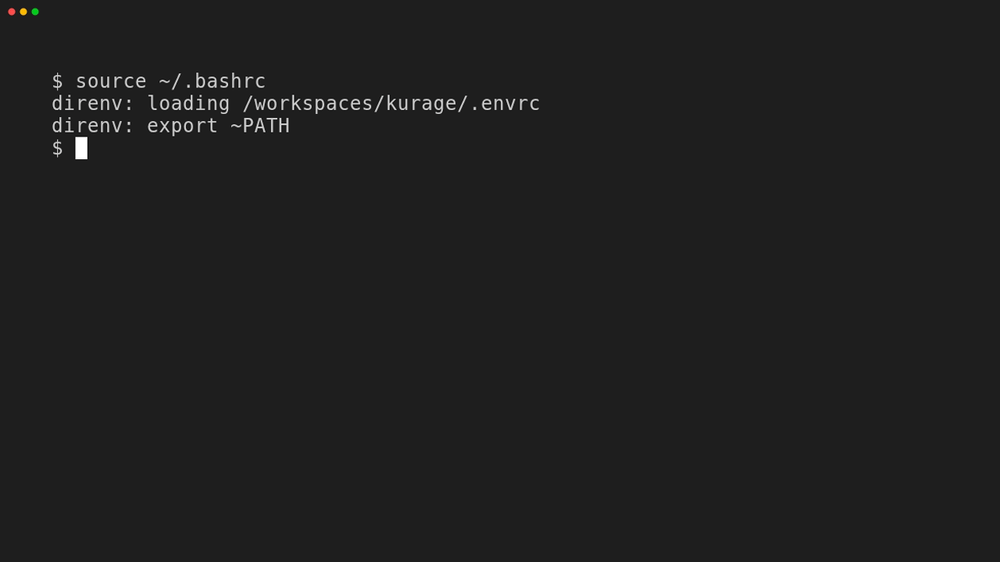

<p align="center"></p>

<p align="center"><a href="https://www.npmjs.com/package/kurage"></a> <a href="https://www.npmjs.com/package/kurage"></a> <a href="LICENSE"></a></p>

[](docs/readme/overview.png)

## Overview

`kurage` is a JavaScript runtime tool that runs on Node.js and Bun.

It provides features useful for development and scripting, including running JavaScript, executing external commands, and retrieving execution results in JSON format.

## Features

- **Multi-runtime support** — Runs on Node.js and Bun
- **Run JavaScript directly** — Evaluate code or run files
- **Run external commands** — Get command results in JSON format
- **Interactive use** — Run JavaScript in a REPL
- **Development APIs** — Provides file operations, text processing, logging, time measurement, and more

## Installation

| Method | Instructions |
| --- | --- |
| Try it in your browser | [](https://codespaces.new/mskz-3110/kurage?quickstart=1)<br>Try Kurage without installing it locally (container build time: about 3 minutes). |
| pnpm | `pnpm add kurage` |
| npx | `npx kurage` |
| Standalone binary | Choose the archive for your OS and architecture from [GitHub Releases](https://github.com/mskz-3110/kurage/releases), then extract it. |

### Release archives

| OS and architecture | Archive |
| --- | --- |
| Linux x64 | `kurage-linux-x64.tar.gz` |
| Linux arm64 | `kurage-linux-arm64.tar.gz` |
| Windows x64 | `kurage-windows-x64.zip` |
| macOS arm64 | `kurage-darwin-arm64.tar.gz` |

Example of extracting and running on Linux x64:

```bash
tar -xzf kurage-linux-x64.tar.gz
./kurage --version
```

### Required versions

| Tool | Required version |
| --- | --- |
| Node.js | 22.23.4 or later |
| Bun | 1.4.5 or later |
| pnpm | 12.23.0 or later |

## Quick Start

The demos show how to use the basic commands.

| Command | Description |
| --- | --- |
| `kurage [repl]` | Run JavaScript interactively |
| `kurage eval <code>` | Execute JavaScript code |
| `kurage exec <command> [args...]` | Run an external command |
| `kurage exec-json <command> [args...]` | Output an external command's results as JSON |
| `kurage [run] <file> [args...]` | Run a JavaScript file |
| `kurage info-json` | Output information about `kurage` and the process as JSON |
| `kurage txcl <files...>` | Embed file contents within marked sections |

### Run interactively


```bash
kurage repl
```

Run `kurage.logger.out('REPL');` in the REPL.

### Run JavaScript directly


```bash
kurage eval "kurage.logger.out('EVAL');"
```

### Run an external command


```bash
kurage exec node -v
```

### Run a JavaScript file


```bash
kurage run examples/log.js
```

## Useful Features

### Get command results as JSON


```bash
kurage exec-json node --version
```

### Get information about the runtime environment


```bash
kurage info-json
```

### Process file contents



```bash
kurage txcl README.md
```

The contents of the specified file are embedded in the section enclosed by `<!-- :< file path { -->` and `<!-- :} -->`.

````markdown
<!-- :< examples/txcl/engines.json {```json -->
<!-- :}``` -->
````

When you specify a file, Kurage updates that file.

When using standard input, Kurage writes the transformed output to standard output.

### JavaScript API

In `eval`, `run`, and the REPL, `kurage` and `$` are available as global variables.

`$` provides APIs such as file operations.

For example, you can read and display a file with `kurage eval`.

```bash
kurage eval "kurage.logger.out($.read('README.md'));"
```

Import `kurage` to use the package.

You can use APIs for command execution, file operations, logging, time measurement, and more.

The `$out` method on the imported `kurage` object returns an external command's standard output as a string.

```js
import kurage from 'kurage';

const output = await kurage.$out(['node', '--version']);
kurage.logger.out(output);
```

## License

[Apache-2.0](LICENSE)
