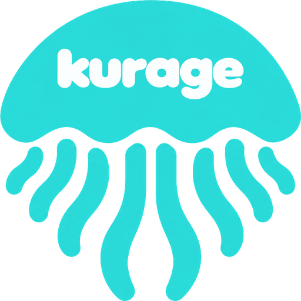
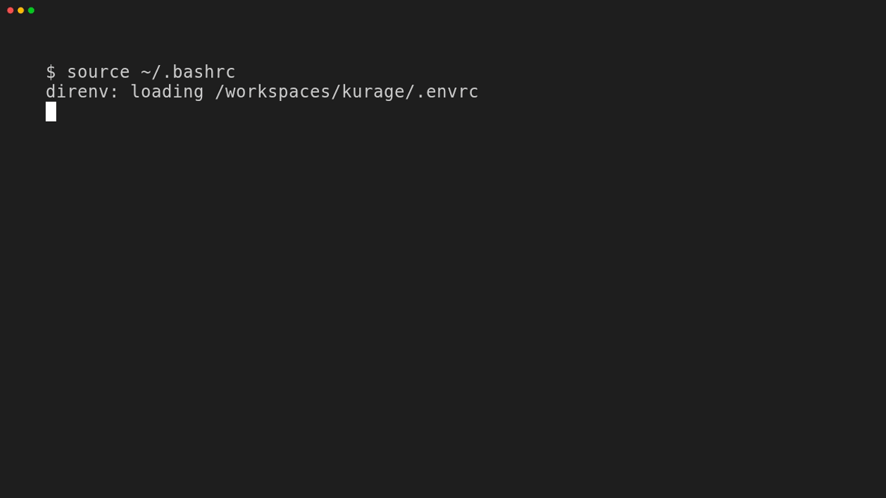

<p align="center"></p>

<p align="center"><a href="https://www.npmjs.com/package/kurage"></a> <a href="https://www.npmjs.com/package/kurage"></a> <a href="LICENSE"></a></p>

[](docs/readme/overview.png)

## Overview

Kurage is a JavaScript runtime tool that runs on Node.js and Bun.

It provides features useful for development and scripting, including running JavaScript, executing external commands, and retrieving execution results in JSON format.

## Features

- **Multi-runtime support** — Runs on Node.js and Bun
- **Run JavaScript directly** — Evaluate code or run files
- **Run external commands** — Retrieve results as JSON with `exec-json`
- **Interactive REPL** — Run JavaScript interactively
- **APIs for development** — Includes file operations, text processing, logging, time measurement, and more

## Installation

| Tool | Required version |
| --- | --- |
| Node.js | 22.23.4 or later |
| Bun | 1.4.5 or later |
| pnpm | 12.23.0 or later |

### Try it in your browser

[](https://codespaces.new/mskz-3110/kurage?quickstart=1)

Use GitHub Codespaces to try Kurage in your browser without installing it locally. (Container build time: about 3 minutes)

### Install with pnpm

```bash
pnpm add kurage
```

### Use as a standalone binary

Download the archive for your OS and architecture from [GitHub Releases](https://github.com/mskz-3110/kurage/releases), then extract it.

| OS and architecture | Archive |
| --- | --- |
| Linux x64 | `kurage-linux-x64.tar.gz` |
| Linux arm64 | `kurage-linux-arm64.tar.gz` |
| Windows x64 | `kurage-windows-x64.zip` |
| macOS arm64 | `kurage-darwin-arm64.tar.gz` |

To extract and run the Linux x64 binary:

```bash
tar -xzf kurage-linux-x64.tar.gz
./kurage --version
```

## Quick Start

These demos show the basic commands.

### Run interactively


```bash
kurage repl
```

At the REPL prompt, run `kurage.logger.out('REPL');`.

### Run JavaScript directly


```bash
kurage eval "kurage.logger.out('EVAL');"
```

### Execute an external command


```bash
kurage exec node -v
```

### Run a JavaScript file


```bash
kurage run examples/log.js
```

## Useful Features

### Get command results as JSON


```bash
kurage exec-json node --version
```

### Get information about the runtime environment



```bash
kurage info-json
```

### Process file contents


```bash
kurage txcl README.md
```

In the marked section, `txcl` inserts the contents of the file named in the opening comment.

````markdown
<!-- :< examples/txcl/engines.json {```json -->
<!-- :}``` -->
````

When you specify a file, Kurage updates that file.

When you use standard input, Kurage writes the transformed output to standard output.

### JavaScript API

Import `kurage` to use the package.

The API includes command execution, file operations, logging, time measurement, and more.

When using `eval`, `run`, or the REPL, `kurage` and `$` are available as global variables.

`$` provides file operations and other features.

The imported `kurage` object’s `$out` method returns an external command’s standard output as a string.

```js
import kurage from 'kurage';

const output = await kurage.$out(['node', '--version']);
kurage.logger.out(output);
```

## License

[Apache-2.0](LICENSE)
